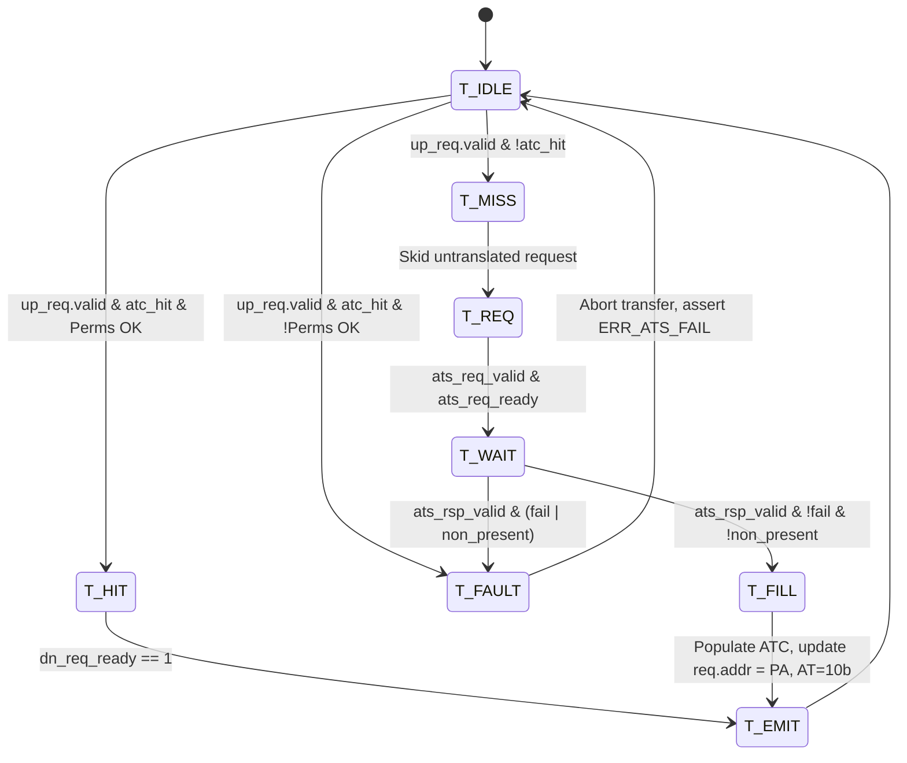

# Design Specification: Milestone M4 ATS, PASID Datapath & Address Translation Cache (ATC)

**Date**: 2026-10-23  
**Status**: Draft for Review  
**Target Milestone**: Milestone M4 (Address Translation Services, PASID Datapath, Address Translation Cache / Device TLB, Invalidation Engine)

---

## 1. Executive Summary & Scope

This specification defines the micro-architecture for Milestone M4 of the IP-Agnostic PCIe Gen4 DMA core. Building upon the Milestone M3 multi-channel scatter-gather linked-list engine and out-of-order completion reorder buffer, Milestone M4 introduces **Shared Virtual Memory (SVM)** hardware support via PCIe **Address Translation Services (ATS)**, the **PASID (Process Address Space ID)** datapath, and an on-chip **Address Translation Cache (ATC / Device TLB)**.

### Core Objectives for M4
1. **Centralized Address Translation Cache (ATC / Device TLB):**
   - 64-entry fully-associative cache located inside [`rtl/blocks/ats_pri_subsys.sv`](file:///home/user/RTL-VIBECODE/DMA/dma_cl/rtl/blocks/ats_pri_subsys.sv) on the unified requester path.
   - Tags: `{pasid_en, pasid[19:0], vpn[63:12]}`.
   - Entry Data: `{ppn[63:12], r_perm, w_perm, priv, valid}`.
   - Page Granularity: Standard 4KB pages (preserves lower 12 bits `addr[11:0]`).
   - Replacement Policy: Round-robin / pseudo-LRU replacement on fills.
   - Performance: 1-cycle latency on ATC hit (zero backpressure bubbles during continuous burst hits).

2. **ATS Translation Agent:**
   - On an ATC miss for an untranslated request (`req.at == AT_UNTRANSLATED` and `ats_en == 1`):
     - Holds the untranslated PCIe request in a translation skid buffer.
     - Issues an ATS Translation Request (`ats_req_*`) over `ats_pri_if` / `ats_up` to the host IOMMU.
     - Captures Translation Completion (`ats_rsp_*` / `ats_dn`), populates the ATC, updates the held request address with the physical PPN, sets `req.at = AT_TRANSLATED` (`2'b10`), and issues the translated TLP to `host_req`.

3. **PASID Datapath Integration:**
   - Integrates per-channel PASID (`pasid[19:0]`), `pasid_en`, and `pasid_priv` configured via `E_RD_PASID` / `E_WR_PASID` CSRs.
   - Carried end-to-end on each channel's request (`ch_req[g].req.pasid`, `ch_req[g].req.pasid_en`), arbitrated transparently through `chan_arbiter.sv`, and tagged onto ATC lookups and PCIe TLP prefixes.

4. **ATC Invalidation Engine:**
   - **Software CSR Invalidation:** Writes to `E_ATC_INVAL` in `csr_block.sv` specifying PASID and address range, triggering targeted or global invalidation flushes.
   - **Host IOMMU Invalidation Messages:** Messages received via `ats_dn` from host IOMMU invalidating matching entries.

5. **Permission Checking & Fault Abortion:**
   - Validates Read (`r`) and Write (`w`) permissions against request type (`is_read`).
   - Hard translation failures (`ats_rsp.fail == 1`) or permission violations abort the transfer, set channel error status to `ERR_ATS_FAIL` (`4'h8`), and strobe channel interrupts.
   - Pages marked `non_present == 1` without PRI (or in M4) abort with `ERR_ATS_FAIL`, providing the exact handoff hook for Milestone M5 PRI page-fault handling.

6. **Directed Verification Suite (`sim/tb_m4.sv`):**
   - Implements a Root Complex + IOMMU BFM supporting ATS Translation Requests, dynamic page tables, Invalidation message injection, and out-of-order data completions.
   - 7 test scenarios validating hit/miss timing, PASID isolation, invalidations, permissions, and multi-channel translated streaming.

---

## 2. Top-Level Datapath Architecture

The subsystem sits between the channel request arbiter (`chan_arbiter.sv`) and the external PCIe host request/completion bus. When ATS is disabled (`ats_en == 0`), the block operates as a transparent zero-latency passthrough.

```
                           Host PCIe & IOMMU Interface
                           │ host_req (Out)     ▲ host_cpl (In)
                           │ host_req_ready     │ host_cpl_ready
                           │ ats_up (Out)       ▼ ats_dn (In)
┌──────────────────────────▼────────────────────┴──────────────────────────────┐
│ dma_top                                                                      │
│                                                                              │
│   ┌───────────┐           ┌───────────────────────────────────────────────┐  │
│   │ csr_block │──ats_ctrl─► ats_pri_subsys (Milestone M4)                 │  │
│   │           │──atc_inval►  ├── 64-Entry ATC (Device TLB)                │  │
│   │           │◄─atc_stat─┤  ├── ATS Translation Agent                    │  │
│   │           │           │  └── ATC Invalidation Engine                  │  │
│   └─────┬─────┘           └───────▲───────────────────────────────┬───────┘  │
│         │                         │ arb_req                       │ arb_cpl  │
│         │ ch_ctrl / ch_stat       │ arb_req_ready                 │          │
│         ▼                         │                               ▼          │
│   ┌───────────┐             ┌─────┴───────────────────────────────────────┐  │
│   │  Channel  │             │                chan_arbiter                 │  │
│   │ Registers │             │       (WRR QoS + Tag Sliced Demux)          │  │
│   └─────┬─────┘             └─────▲───────────────────────────────▲───────┘  │
│         │                         │                               │          │
│         ▼                         │ ch_req[0..7]                  │ ch_cpl   │
│   ┌───────────────────────────────┴───────────────────────────────┴───────┐  │
│   │ dma_channel [0..7] (H2C Read Channels 0..3 / C2H Write Channels 4..7) │  │
│   └───────────────────────────────────────────────────────────────────────┘  │
└──────────────────────────────────────────────────────────────────────────────┘
```

---

## 3. ATC (Device TLB) Architecture

### 3.1 Entry Definition (`atc_entry_t`)
Each of the 64 ATC entries stores a virtual-to-physical address translation binding with associated permissions and ownership tags:

```systemverilog
typedef struct packed {
  logic        valid;
  logic        pasid_en;
  logic [19:0] pasid;
  logic [51:0] vpn;         // Virtual Page Number: addr[63:12]
  logic [51:0] ppn;         // Physical Page Number: trans_addr[63:12]
  logic        r_perm;      // Read permission allowed
  logic        w_perm;      // Write permission allowed
  logic        priv;        // Privileged access allowed
} atc_entry_t;
```

### 3.2 Lookup Matching & Hit Logic
For an incoming request with `{pasid_en, pasid, addr}`:
```systemverilog
wire [51:0] req_vpn = up_req.req.addr[63:12];
logic [63:0] atc_hit_mask;

for (int i = 0; i < 64; i++) begin
  assign atc_hit_mask[i] = atc_mem[i].valid &&
                          (atc_mem[i].vpn == req_vpn) &&
                          (!atc_mem[i].pasid_en || (atc_mem[i].pasid == up_req.req.pasid));
end

wire atc_hit = |atc_hit_mask;
```

### 3.3 Page Replacement Policy
The ATC maintains a 64-bit replacement pointer (`replace_ptr`). On a translation fill:
1. Search for any invalid entry (`!atc_mem[i].valid`). If found, allocate the first invalid slot.
2. If all entries are valid, replace entry `replace_ptr` and increment `replace_ptr <= replace_ptr + 1'b1` (FIFO / Round-Robin).

---

## 4. ATS Translation Agent FSM

The translation agent intercepts requests on `up_req`. If `ats_en` is disabled, it acts as a combinational wire to `dn_req`. When `ats_en` is enabled, it executes the following state machine:



### 4.1 FSM State Descriptions

1. **`T_IDLE`**:
   - Listens for `up_req.valid`.
   - Performs parallel combinatorial tag lookup across all 64 ATC entries.
   - If `atc_hit`:
     - Checks permissions: `(up_req.req.is_read && r_perm) || (!up_req.req.is_read && w_perm)`.
     - If permissions pass: transitions to `T_EMIT`.
     - If permissions fail: transitions to `T_FAULT`.
   - If `!atc_hit`:
     - Latches request into `skid_req` and transitions to `T_REQ`.

2. **`T_REQ`**:
   - Asserts `ats_up.ats_req_valid = 1'b1`.
   - Assigns `ats_up.ats_req_addr = {up_req.req.addr[63:12], 12'b0}`.
   - Assigns `ats_up.ats_req_pasid = up_req.req.pasid`.
   - Assigns `ats_up.ats_req_pasid_en = up_req.req.pasid_en`.
   - Assigns `ats_up.ats_req_is_write = !up_req.req.is_read`.
   - Assigns `ats_up.ats_req_id = cur_req_id`.
   - When `ats_dn.ats_req_ready == 1'b1`, deasserts `ats_req_valid` and enters `T_WAIT`.

3. **`T_WAIT`**:
   - Awaits `ats_dn.ats_rsp_valid`.
   - On match (`ats_dn.ats_rsp_id == cur_req_id`):
     - If `ats_dn.ats_rsp.fail || ats_dn.ats_rsp.non_present`: transition to `T_FAULT`.
     - Else: write translation into ATC entry, substitute `skid_req.addr = {ats_dn.ats_rsp.trans_addr[63:12], skid_req.addr[11:0]}`, set `skid_req.at = AT_TRANSLATED` (`2'b10`), and transition to `T_EMIT`.

4. **`T_EMIT`**:
   - Drives translated request onto `dn_req` (`host_req`).
   - Asserts `dn_req.valid = 1'b1`.
   - When `dn_req_ready == 1'b1`, completes request emission, frees skid buffer, and returns to `T_IDLE`.

5. **`T_FAULT`**:
   - Drops the faulting request.
   - Raises internal fault flag with channel index `up_req.req.tag[9:7]`.
   - Strobes channel abort/error status with `ERR_ATS_FAIL` (`4'h8`).
   - Returns to `T_IDLE`.

---

## 5. ATC Invalidation Architecture

Invalidation guarantees coherency between host OS virtual memory mappings (IOMMU page tables) and the DMA device TLB.

### 5.1 Invalidation Sources
1. **Host IOMMU Invalidation Messages (`ats_dn`):**
   - The IOMMU broadcasts Invalidation Request TLPs across PCIe on page unmaps.
   - Decoded into `ats_dn.inval_valid`, `ats_dn.inval_pasid`, `ats_dn.inval_pasid_en`, `ats_dn.inval_addr`, `ats_dn.inval_global`.
2. **Software CSR Register Invalidation (`E_ATC_INVAL` = `0x9304`):**
   - Software writes `ATC_INVAL` register:
     - Bit `[0]`: `EXEC` (1 = trigger invalidation strobe).
     - Bit `[1]`: `GLOBAL` (1 = flush entire ATC).
     - Bit `[2]`: `PASID_ALL` (1 = flush all entries matching PASID).
     - Bits `[31:12]`: `VPN` (Virtual Page Number to flush).

### 5.2 Invalidation Execution
Invalidation executes in a single clock cycle across all 64 entries:
```systemverilog
for (int i = 0; i < 64; i++) begin
  if (inval_global) begin
    atc_mem[i].valid <= 1'b0;
  end else if (atc_mem[i].valid) begin
    if (inval_pasid_en && (atc_mem[i].pasid == inval_pasid)) begin
      if (inval_pasid_all || (atc_mem[i].vpn == inval_vpn)) begin
        atc_mem[i].valid <= 1'b0;
      end
    end else if (!inval_pasid_en && (atc_mem[i].vpn == inval_vpn)) begin
      atc_mem[i].valid <= 1'b0;
    end
  end
end
```

---

## 6. CSR Block Extensions (`csr_block.sv`)

The vendor-defined extension region (`0x9000`–`0x9FFF`) provides full control and status reporting for ATS and ATC:

| Offset | Register Name | R/W | Field Definitions |
|---|---|---|---|
| `0x9110 + n*8` | `E_RD_PASID[n]` | R/W | `[19:0]`: PASID, `[20]`: PASID_EN, `[21]`: PRIV (Read Channel `n`) |
| `0x9210 + n*8` | `E_WR_PASID[n]` | R/W | `[19:0]`: PASID, `[20]`: PASID_EN, `[21]`: PRIV (Write Channel `n`) |
| `0x9300` | `E_ATS_CTRL` | R/W | `[0]`: `ATS_EN` (1 = enable ATS/ATC), `[1]`: `TIMEOUT_EN`, `[15:8]`: `TIMEOUT_CYCLES` |
| `0x9304` | `E_ATC_INVAL` | W1S | `[0]`: `TRIGGER`, `[1]`: `GLOBAL`, `[2]`: `PASID_ALL`, `[19:4]`: `PASID`, `[31:20]`: `VPN[23:12]` |
| `0x9308` | `E_ATC_STATUS` | RO | `[15:0]`: `ATC_HIT_COUNT`, `[31:16]`: `ATC_MISS_COUNT` |

---

## 7. Verification Plan (`sim/tb_m4.sv`)

The verification suite validates the complete ATS, PASID, and ATC datapath using an integrated Root Complex and IOMMU behavioral model.

```
┌──────────────────────────────────────────────────────────┐
│ tb_m4                                                    │
│                                                          │
│  ┌─────────────────────────┐   ┌──────────────────────┐  │
│  │ IOMMU Behavioral Model  │   │ PCIe RC BFM          │  │
│  │  - Page Table Array     │   │  - Request intake    │  │
│  │  - ATS Req/Rsp Engine   │   │  - Completion engine │  │
│  │  - Invalidation Inject  │   │  - Host Memory (4MB) │  │
│  └───────────▲─────────────┘   └──────────▲───────────┘  │
│              │ ats_up/dn                  │ host_req/cpl │
│  ┌───────────┴────────────────────────────┴───────────┐  │
│  │ dma_top (DUT)                                      │  │
│  │  ├── chan_arbiter                                  │  │
│  │  ├── ats_pri_subsys (ATC + Translation Agent)     │  │
│  │  └── 8x dma_channel (with 8 Device AXI RAM models) │  │
│  └────────────────────────────────────────────────────┘  │
└──────────────────────────────────────────────────────────┘
```

### Directed Test Matrix (`sim/tb_m4.sv`)

| Test # | Test Name | Target Functionality | Expected Result |
|---|---|---|---|
| **Test 1** | ATS Disabled Passthrough | Verify backwards compatibility with `ATS_CTRL.en = 0`. Untranslated requests pass directly. | Baseline transfers succeed with `req.at = 00b`. |
| **Test 2** | ATC Miss & Translation Fill | Untranslated Read request causes ATC miss. IOMMU BFM returns physical translation. ATC fills, request emits with `AT=10b`. | Read completes from translated physical address; data verified in AXI RAM. |
| **Test 3** | ATC Hit Steady-State Streaming | Consecutive transfers to same virtual page hit ATC without extra translation latency. | Zero-cycle translation stall; maximum throughput sustained. |
| **Test 4** | Translated Write (`MWr`) & PASID | C2H Write channel issues transfer with PASID enabled. Request translated to PA with PASID prefix. | Host memory receives write data at translated PA. |
| **Test 5** | Multi-Channel PASID Isolation | Channel 0 (PASID 0x1) and Channel 1 (PASID 0x2) map the *same* virtual address (`0x0000_A000`) to *different* physical addresses. | Each channel accesses its own isolated physical memory without collision. |
| **Test 6** | ATC Invalidation (CSR & Host Message) | Invalidate populated ATC entry via CSR write. Verify subsequent access misses and re-translates. | ATC miss counter increments; re-translation succeeds. |
| **Test 7** | Permission Violation & Fault Abortion | Attempt write to a Read-Only page (`w_perm = 0`) and request unmapped address (`fail = 1`). | Transfer aborts; channel reports `ERR_ATS_FAIL` (`4'h8`); error interrupt asserts. |

---

## 8. Definition of Done & Quality Gates

1. **RTL Synthesizability:**
   - Full synthesizable SystemVerilog (IEEE 1800-2012).
   - Zero vendor-specific primitives in synthesizable paths.
   - Clean lint passing with `make lint` and `make lint-if` (0 errors, 0 warnings).
2. **Backwards Compatibility:**
   - Full regression suite passing: `make lint && make lint-if && make sim-csr && make sim-m2 && make sim-m3`.
3. **Milestone M4 Verification:**
   - `make sim-m4` builds and executes cleanly with `[tb_m4] ALL TESTS PASSED (0 errors)`.
